  

# 📑 Awesome Contract Master Data Management (MDM) 🌟

  <strong>A curated index of top SaaS platforms, open-source libraries, and tools for golden record creation, entity resolution, and cross-system contract data consistency.</strong>

  
  
  
  
  

  <em>Last updated: March 2026 • Curated for Data Governance Teams, MDM Architects, Procurement Stewards, and Data Engineers.</em>

---

## 📖 Executive Summary & Core Concepts

**Contract Master Data Management (Contract MDM)** is the discipline, architectural framework, and technology suite used to synthesize and govern a singular, authoritative **"Golden Record"** for all contract-related business entities. In large enterprises, contract data is fragmented across customer relationship management (CRM), enterprise resource planning (ERP), contract lifecycle management (CLM), supply chain, and procurement suites.

Contract MDM platforms solve this fragmentation by providing:
- 🔍 **Probabilistic Entity Resolution & Deduplication**: Disambiguating legal counterparty variations, subsidiaries, DBA names, and legacy vendor accounts.
- 🔗 **Hierarchical Graph Relationship Modeling**: Mapping complex corporate structures, parent-subsidiary relationships, supplier tiers, and global legal entities.
- 🛡️ **Data Stewardship & Approval Governance**: Enforcing role-based authorization rules and validation workflows before sensitive contract fields (such as payment terms, bank accounts, or tax identifiers) are modified.
- ⚡ **Cross-System Synchronization**: Propagating golden master attributes bi-directionally across Salesforce, SAP, Oracle, Icertis, Coupa, and Snowflake.

---

## 📑 Table of Contents
- [📊 Sector Overview & Market Dynamics](#-sector-overview--market-dynamics)
- [☁️ SaaS/Hosted Platforms](#️-saashosted-platforms)
- [💻 Open-Source GitHub Projects](#-open-source-github-projects)
- [🤝 How to Contribute](#-how-to-contribute)
- [💖 Support & Sponsorship](#-support--sponsorship)
- [⭐ Star History](#-star-history)
- [⚠️ Disclaimer](#️-disclaimer)

---

## 📊 Sector Overview & Market Dynamics

The global Master Data Management (MDM) software market is estimated at **$21 billion to $30 billion**, expanding at a robust double-digit CAGR of **13% to 18%** as enterprises modernize cloud architectures and feed governed data into AI and automated contract engines. The sector is **moderately fragmented** rather than a winner-take-all monopoly: while legacy titans (SAP, Informatica) capture large-scale enterprise suites, agile multi-domain specialists (Reltio, Semarchy, Profisee) and vertical CLM master-data leaders (Icertis) command substantial niches across entity resolution, product data, and contract lifecycle integration.

---

## ☁️ SaaS/Hosted Platforms

*Ranked by company size (valuation / annual revenue in descending order).*

| Product | Company Size (Valuation / Revenue) | Description | Starting Pricing | Free Tier / Trial Limits |
|:---|:---|:---|:---|:---|
| **[SAP Master Data Governance](https://www.sap.com/)** | ~$270B Market Cap / ~$45B TTM Rev | MDM embedded within SAP S/4HANA & BTP. Central governance for supplier, customer, and material master data with approval workflows and consolidation. Tight integration with SAP ERP. | Starting at ~$87/month (SAP BTP consumption blocks of 5,000 managed objects/month; enterprise S/4HANA licenses quoted separately) | Perpetual Free Tier available on SAP BTP Discovery Center (restricted low-volume test quota; no production SLA) |
| **[Informatica MDM](https://www.informatica.com/)** | ~$7.6B Market Cap / ~$1.68B ARR | Multi-domain MDM (IDMC platform) with AI-powered match-and-merge, graph-based relationship modeling, and automated data stewardship workflows. | Starting at ~$200,000/year (billed via annual IPU consumption contracts based on mastered record volume) | No self-service free tier or free trial; 30-day guided enterprise Proof of Concept (PoC) arranged via sales |
| **[Tibco EBX](https://www.tibco.com/)** | ~$1.5B Revenue (Cloud Software Group) | Unified multi-domain MDM and data governance platform (ON EBX). Model-driven approach with advanced workflow orchestration and data stewardship. | Starting at ~$100,000/year (annual enterprise subscription scaled by managed domains, CPU cores, and seat volume) | No self-service free tier or trial; guided custom evaluation sandbox available via enterprise sales |
| **[Icertis](https://www.icertis.com/)** | ~$5.0B Valuation / ~$350M ARR | Contract intelligence platform featuring Global Master Data Management capabilities for legal counterparties, corporate hierarchies, and contract metadata. | Starting at ~$100,000/year (enterprise contract structured around contract volume, add-on AI modules, and named stewards) | No free tier or self-service trial; interactive guided product demonstration coordinated via sales |
| **[Reltio](https://www.reltio.com/)** | ~$1.7B Valuation / ~$185M ARR | Cloud-native multi-domain MDM offering real-time entity resolution, graph relationship modeling, and automated match-and-merge. | Starting at ~$120,000/year (annual subscription scaled by mastered entity profiles and active connected sources) | No self-service free trial; guided sandbox evaluation & interactive platform tour available via sales request |
| **[Stibo Systems](https://www.stibosystems.com/)** | ~$195M Revenue (€176M FY25/26) | STEP multi-domain MDM with deep PIM and supplier lifecycle management heritage. Used heavily in retail and manufacturing for complex contract supplier master records. | Starting at ~$150,000/year (annual enterprise subscription based on domains, data volume, and deployment model) | No free tier or public trial; custom guided Proof of Concept (PoC) provided via sales consultation |
| **[Ataccama ONE](https://www.ataccama.com/)** | ~$70M Revenue / ~$550M Valuation | AI-driven data management platform combining data profiling, automated data quality, entity resolution, and master data stewardship in one suite. | Starting at ~$90,000/year (annual subscription scaled by processed records and active data quality configurations) | Free tier available via **Ataccama ONE Free Profiler** (browser-based data profiling file upload; no automated sync/MDM engine); enterprise MDM requires sales evaluation |
| **[Profisee](https://profisee.com/)** | ~$30M ARR (backed by Resurgens) | Fast-deploying MDM platform built natively for Microsoft Azure and Microsoft Fabric, providing turnkey stewardship, golden record mastering, and ERP integration. | Starting at ~$30,000/year (annual subscription scaled by mastered record volume tiers; excludes Azure infrastructure costs) | No self-service free trial on Azure/AWS Marketplace; pre-configured evaluation workload offered inside Microsoft Fabric |
| **[Semarchy xDM](https://www.semarchy.com/)** | ~$25M ARR (backed by PSG) | Unified "Intelligent Data Hub" providing multi-domain MDM, entity resolution, and governance with a single data model and workflow-driven stewardship. | Starting at £62,000/year (~$78,000/year via UK G-Cloud for up to 50,000 base objects with unlimited users) | Free 30-day proof-of-value sandbox license available upon request via Semarchy website |
| **[Pimcore](https://pimcore.com/)** | ~$10M ARR (backed by Verdane) | Open-core digital data platform combining MDM, PIM, DAM, and DXP. Enforces golden record creation and master attributes across enterprise assets. | Professional Edition: $9,900/year; Enterprise Edition: $29,900/year; PaaS: $39,000/year | Perpetual Free Tier via Community Edition strictly for organizations with ≤€5M ($5.4M) annual turnover; commercial organizations >€5M require paid license |

---

## 💻 Open-Source GitHub Projects

*Ranked by GitHub star count in descending order. Star badges link directly to each repository's stargazers.*

| Project | Stars | License | Description |
|:---|:---|:---|:---|
| **[OpenMetadata](https://github.com/open-metadata/OpenMetadata)** |  | Apache 2.0 | Metadata catalog and governance platform. While not a standalone MDM match-and-merge engine, it provides critical schema discovery, data lineage, and contract data dictionary governance across distributed databases. |
| **[DataHub](https://github.com/datahub-project/datahub)** |  | Apache 2.0 | Extensible metadata search and lineage platform originally developed by LinkedIn. Complements MDM systems by mapping contract dependencies, source pipelines, and end-to-end data provenance. |
| **[Dedupe](https://github.com/dedupeio/dedupe)** |  | MIT | Machine-learning-powered Python library for entity resolution, record linkage, and deduplication. Uses active learning to train matching models on minimal human annotations. |
| **[Pimcore](https://github.com/pimcore/pimcore)** |  | POCL / GPLv3 | Open-source enterprise MDM, PIM, DAM, and customer data platform built on Symfony and PHP. Fully functional master data repository with flexible data modeling (Community Edition subject to €5M revenue threshold). |
| **[Splink](https://github.com/moj-analytical-services/splink)** |  | MIT | Ultra-fast probabilistic entity resolution and record linkage library implementing the Fellegi-Sunter model. Scales across millions of records using DuckDB, Apache Spark, PostgreSQL, or AWS Athena. |
| **[Zingg](https://github.com/zinggAI/zingg)** |  | AGPL-3.0 | AI/ML-driven entity resolution and master data management framework designed for modern data stacks. Runs natively on Apache Spark, Snowflake, Databricks, and BigQuery to resolve identity clusters and golden records. |
| **[Python Record Linkage Toolkit](https://github.com/J535D165/recordlinkage)** |  | BSD-3-Clause | Comprehensive Python library for record linkage and data deduplication. Provides traditional indexing/blocking techniques, string comparison algorithms, and supervised/unsupervised classifiers. |
| **[AtroCore / AtroPIM](https://github.com/atrocore/atrocore)** |  | GPLv3 | Actively maintained open-source MDM/PIM candidate built in PHP and Vue.js. Supports PostgreSQL, MySQL, and MariaDB with built-in match-and-merge, data quality rules, and stewardship workflows (ERP integrations available via premium modules). |
| **[miniMDM](https://github.com/planemarlin/minimdm)** |  | MIT | Lightweight self-hosted master data management and governance hub built with modern Python (FastAPI). Designed for quick-start data steward validation and golden record APIs. |
| **[Yugandhar Open MDM Hub](https://github.com/yugandharproject/yugandhar-open-mdmhub)** |  | Apache 2.0 | Open-source enterprise MDM hub for customer and organization data integration. Built on Spring Boot and Hibernate with 450+ prebuilt REST/MQ services and reference match-and-merge architecture. |
| **[open-mdm](https://github.com/open-mdm/open-mdm)** |  | MIT | Microservice-based master data management hub built on Java and Spring Boot, offering REST APIs for dynamic domain definitions and master record governance. |
| **[Shillinq](https://github.com/ConductionNL/shillinq)** |  | EUPL-1.2 | Nextcloud-based contract repository, supplier management, and PO revision tracking suite with supplier qualification and approval chains touching master data governance. |

---

## 🤝 How to Contribute

Contributions make the open-source community an incredible place to learn, inspire, and create! Any contributions you make are **greatly appreciated**.

1. 🍴 **Fork the Project**
2. 🌿 **Create your Feature Branch** (`git checkout -b feature/AmazingMDMFeature`)
3. 💾 **Commit your Changes** (`git commit -m 'Add new MDM / entity resolution tool'`)
4. 🚀 **Push to the Branch** (`git push origin feature/AmazingMDMFeature`)
5. 📬 **Open a Pull Request**

Please ensure your entries include factual descriptions, verified starting prices, license information, and live links.

---

## 💖 Support & Sponsorship

Thank you for visiting and using this resource! Maintaining open-source repositories and high-quality curations takes dedication and ongoing research.

If you found this guide helpful:
- ⭐ **Star this repository** to help others discover it on GitHub!
- 🍴 **Fork and share** it with your data governance, legal engineering, and architecture teams.
- ☕ **Buy me a coffee / Sponsor**: If you'd like to support ongoing maintenance and new open-source initiatives, consider sponsoring via the [GitHub Sponsor Dashboard](https://github.com/sponsors/ishandutta2007). Your support is deeply appreciated!

  

---

##  Star History

---

## ⚠️ Disclaimer

- 📌 This is a **community-curated** list — not exhaustive and not an endorsement.
- 🔒 MDM platforms govern critical master data (supplier bank accounts, legal entity names, pricing structures); always enforce strict approval workflows, audit trails, and segregation of duties. A wrong golden record propagates across all integrated downstream systems.
- 💡 **The open-source MDM landscape is thinner than it appears.** Talend Open Studio for MDM was retired in January 2024 and receives no security patches. Pimcore's Community Edition has a €5M revenue threshold. AtroCore is an active GPL candidate, but its ERP integrations are paid modules. Data catalogs (OpenMetadata, DataHub) are complementary governance tools rather than transactional golden-record engines.

---

  <strong>Made with ❤️ for data governance teams, MDM architects, procurement data stewards, and developers building master data infrastructure.</strong>

